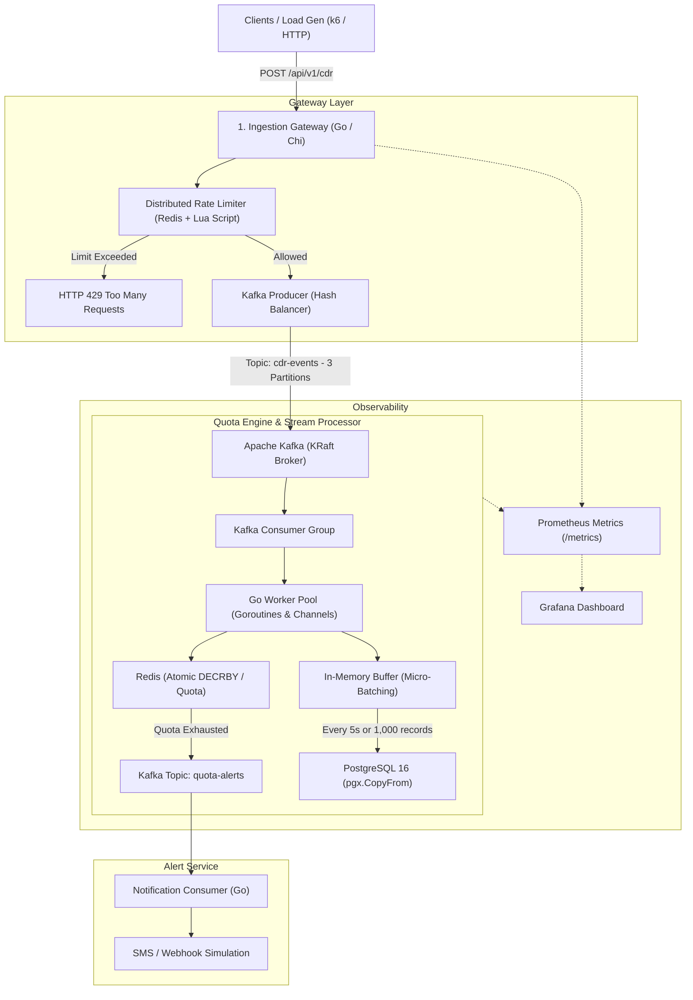

# TelcoStream: High-Throughput Real-Time Telecom Quota & Distributed Rate-Limiting Engine

[](https://golang.org)
[](https://www.docker.com/)
[](https://kafka.apache.org/)
[](https://redis.io/)
[](https://www.postgresql.org/)

TelcoStream is a high-performance streaming engine designed to ingest tens of thousands of **CDR (Call Detail Record)** usage events per second generated by telecom core network elements (GGSN, PGW, 5G UPF). It deducts subscriber data quotas in real time, mitigates distributed API abuse via Redis Lua scripts, and durably persists high-volume records using database micro-batching.

---

## 📌 System Architecture



---

## 🚀 Current Status (Completed Milestones)

The first two core phases of the system are implemented and verified live:

* [x] **Infrastructure (Docker Compose):** Containerized ZooKeeper-less **Kafka (KRaft Mode)**, **Redis 7 (Alpine)**, and **PostgreSQL 16 (Alpine)**.
* [x] **Domain Layer:** Defined standard CDR models with strict telecom business rule validation (`Validate()`).
* [x] **Kafka Producer:** Implemented using pure Go (`segmentio/kafka-go`) with a `SubscriberID`-based hash partitioning strategy (guarantees strictly ordered event processing per subscriber).
* [x] **Ingestion HTTP Gateway:** Asynchronous ingestion endpoint powered by `go-chi/chi/v5` returning `HTTP 202 Accepted`.
* [x] **Graceful Shutdown:** Production-ready lifecycle management handling `SIGINT` and `SIGTERM` with bounded context timeouts.
* [x] **Partitioning & Topologies:** Topic `cdr-events` configured with 3 partitions for horizontal consumer scalability.

---

## 🛠️ Roadmap (Upcoming Phases)

* [ ] **Phase 3 (Distributed Rate Limiter):** Redis Sorted Set (ZSET) atomic **Sliding Window Log** middleware using embedded Lua scripts.
* [ ] **Phase 4 (Quota Engine & Worker Pool):** Fixed-size Goroutine Worker Pool with backpressure controls and Redis atomic `DECRBY` balance updates.
* [ ] **Phase 5 (PostgreSQL Micro-Batching):** Write-behind caching buffer flushing via `time.Ticker` using high-speed binary `pgx.CopyFrom`.
* [ ] **Phase 6 (Observability & Load Testing):** Prometheus metrics instrumentation, Grafana visualization, and 2,000+ RPS stress testing via `k6`.
* [ ] **Phase 7 (Integration Testing):** Hermetic integration test suite utilizing `testcontainers-go`.

---

## 💻 Quickstart

### 1. Prerequisites
* **Go** (1.27 or higher)
* **Docker Desktop** (WSL 2 backend on Windows)

### 2. Start Infrastructure
```bash
cd deployments
docker compose up -d
```

### 3. Launch Ingestion Gateway
```bash
go run cmd/gateway/main.go
```

### 4. Send Sample CDR Event (PowerShell / cURL)
```powershell
Invoke-RestMethod -Uri "http://localhost:8080/api/v1/cdr" -Method Post -ContentType "application/json" -Body '{"event_id":"evt-101","subscriber_id":"5321112233","data_used_mb":50,"cell_tower_id":"IST-KADIKOY-01"}'
```

**Expected Response:**
```json
{
  "status": "accepted",
  "event_id": "evt-101"
}
```

---

## 🧠 Key Engineering Problems Solved

1. **Race Conditions in Distributed Environments:** Leverages single-threaded Redis Lua scripts to execute rate-limiting checks and quota mutations atomically across multiple gateway instances.
2. **Strict Per-Subscriber Ordering:** Uses `SubscriberID` as the Kafka partition hashing key so subsequent usage events for a subscriber always land on the same partition in sequential order.
3. **Memory Safety & Backpressure (OOM Prevention):** Replaces unbounded goroutine dispatching with fixed worker pools, exerting backpressure on upstream Kafka consumers when downstream capacity is saturated.
4. **Relational Database Bottleneck Mitigation:** Decouples transactional disk writes from hot request paths using in-memory state deduction paired with micro-batched bulk persistence (`pgx.CopyFrom`).

---

## 📦 Tech Stack

| Component | Library / Technology | Purpose |
| :--- | :--- | :--- |
| **HTTP Routing** | `github.com/go-chi/chi/v5` | Lightweight, idiomatic router with zero memory allocations |
| **Event Streaming** | `github.com/segmentio/kafka-go` | Pure Go Kafka client (no CGo/librdkafka dependencies) |
| **In-Memory Cache & Limiter** | `github.com/redis/go-redis/v9` | Sub-millisecond atomic state and Lua scripting runtime |
| **Relational Storage** | `github.com/jackc/pgx/v5` | High-performance PostgreSQL driver supporting binary batch copy |
| **Observability** | `github.com/prometheus/client_golang` | Application metrics exporter (`/metrics`) |
